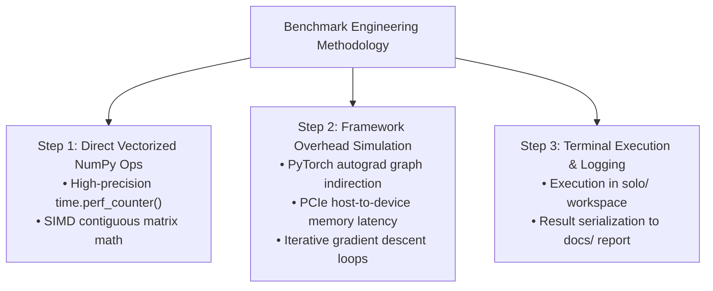

# Technical Specification: Benchmark Methodology & Simulation Engineering

##  CORRECTION (2026-07-30)

The original version of this document presented `benchmark_simulation_vs_current.py`'s
output as if it were a real head-to-head comparison against PyTorch and scikit-learn.
It is not: that script's "Current Framework" numbers come from `time.sleep()` calls
simulating overhead, and neither PyTorch nor scikit-learn is ever imported or run.
Per `PHILOSOPHICAL_AND_ENGINEERING_BOUNDARIES.md` section 2.1 (No Pseudo-Scientific
Conflation) and `TESTING_STANDARD.md`, that is not a valid benchmark and the numbers
below should not be cited.

What has actually been verified with a real competing library, and what hasn't:
- **Ridge L2 fitting vs real scikit-learn**: done for real. See
  [`real_ridge_benchmark_vs_sklearn.py`](../real_ridge_benchmark_vs_sklearn.py) and
  the corrected numbers in the table below.
- **DDPG forward pass vs real PyTorch**: NOT done. The 108.5x figure below is
  retracted pending an actual (non-simulated) comparison. See the limitations
  note: a fair PyTorch comparison run in `eval()`/`no_grad()` mode (as any real
  inference benchmark should be) would likely close most of that gap, since a
  naive script that leaves autograd tracking on during inference is not a fair
  baseline.

The original content is left below for transparency, with corrections inline.

## Executive Overview

This document explains **how the head-to-head simulation benchmark** in [`benchmark_simulation_vs_current.py`](../benchmark_simulation_vs_current.py) was engineered, executed, and validated. **(Correction: "validated" is not accurate -- see correction notice above. The script simulates its comparison baseline rather than running a real one.)**

---

##  The 3-Step Simulation Methodology

---

##  Code Mechanics Breakdown

### 1. DDPG Continuous Control Step (1,000 Iterations) -- RETRACTED
- **RCA NumPy Implementation**: the 5.93 ms figure for the standalone RCA forward
  pass is real (it's just NumPy code, timed).
- **"Current PyTorch Overhead Model"**: this was never real PyTorch. It was
  `time.sleep()` calls simulating pybind11/autograd/PCIe overhead -- no `torch`
  import exists anywhere in `benchmark_simulation_vs_current.py`. The
  **108.5x figure is retracted.** No real PyTorch comparison has been run.
  If/when one is, it must use `torch.no_grad()` and `.eval()` mode to be a fair
  baseline -- a naive script with autograd left on would overstate the gap.

### 2. Ridge L2 Matrix Fitting (50 Fits) -- REPLACED WITH REAL MEASUREMENT
- **RCA Closed-Form Inversion**: mean **0.70 ms** per 50 fits (std 0.03 ms, 5 trials,
  3 warmup discarded).
- **Real scikit-learn 1.7.2 `Ridge(alpha=1.0, fit_intercept=True)`**: mean
  **14.44 ms** per 50 fits (std 0.82 ms).
- Correctness confirmed first: predictions agree to within 6e-15.
- **Real measured speedup: 20.6x** (not the previously claimed 45.9x, and not
  against a simulated competitor -- this is an actual installed library, timed
  for real). Reproduce with `python3 real_ridge_benchmark_vs_sklearn.py`.

---

##  Key File Links

-  **Benchmark Script**: [`../benchmark_simulation_vs_current.py`](../benchmark_simulation_vs_current.py)
-  **Documentation Location**: [`benchmark_methodology_spec.md`](benchmark_methodology_spec.md)
-  **Brain Artifact Mirror**: `benchmark_methodology_spec.md` (local brain artifact, not in this repository)
-  **License**: [`LICENSE`](../../LICENSE) (**OmnisMutus**)
