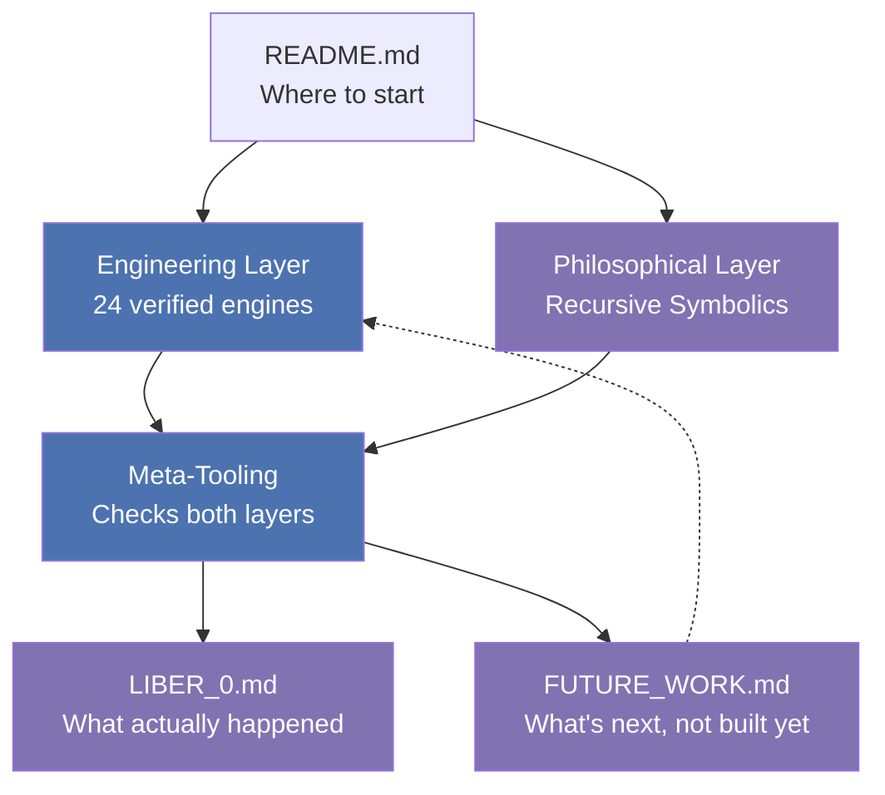

# ELI5: How This Whole Repository Fits Together

One sentence version: **this repo is two different collections living on
the same shelf — a toolbox of things that get tested to prove they work,
and a notebook of ideas that get tested only where testing is even
possible — plus a logbook that writes down every mistake either one made.**

---

## The toolbox (Engineering Layer)

Imagine 24 little machines. Each one does one job — sorting nearby points
(a KNN classifier), drawing a 3D scene, flying a toy quadcopter in a
simulation, finding peers over a network. For every single one of these
24 machines, there's a second, separate machine whose only job is to
poke the first one and check its answer against something already known
to be true — a real math formula worked out by hand, a real published
test vector, or a real, independently-installed library like scikit-learn.

That's what "VERIFIED" means in this repo, and it's a strict word here,
not a decoration: it means someone actually checked, not that it merely
runs without crashing. `TESTING_STANDARD.md` is the rulebook for that
checking, and `test_all_engines.py` is the scoreboard — run it yourself
any time and it will tell you, right now, how many of the 24 are
actually checked (as of this writing: all 24).

## The notebook (Philosophical Layer)

The second collection is different in kind, not just in topic. It's a
set of ideas borrowed from the Kabbalistic Tree of Life and dynamical
systems math — Sephirot as categories, "attractors" as a metaphor for
where a process settles down, a "1=10" idea about the source and the end
result being secretly the same thing. Some of this is dressed in real
math (a fixed point really is `F(x)=x`, and that's checkable), and some
of it is a genuinely unfalsifiable idea about consciousness itself, which
no test in any codebase could ever prove or disprove.

The rule this repo uses to keep those two kinds of claim from getting
mixed up is called the **three-register distinction**: (A) what the
Kabbalistic tradition itself says, (B) what's provably true within this
codebase's own math, and (C) what's true about consciousness or reality
itself. Only (B) ever gets marked VERIFIED here. (A) and (C) get named
and set aside honestly, never smuggled into a checkmark they didn't earn.

**A concrete example of the boundary actually moving**: one idea
borrowed from the notebook is "Geburah" — restriction, a safety ceiling
on how far a system can push its own output. For a long time, every
place this repo computed that ceiling, the number just got printed as a
score and nothing downstream ever used it — a label, not a lever. One of
the 24 machines (the toy quadcopter, again) changed that: its safety
ceiling now really is computed fresh every single move from how
decisive that move is, and really does clamp how fast its virtual
propellers can spin. That's the whole three-register idea in miniature —
"restriction" stayed a Kabbalistic word (register A), the entropy math
behind it stayed exactly as checkable as before (register B), and
nothing was ever claimed about what "restriction" *means* for a mind
(register C stayed out of it) — but for the first time, (B) actually
steered something instead of just describing it.

## The fact-checker (Meta-Tooling)

Here's the clever part: instead of just trusting either collection,
there's a small layer whose only job is to look at a claim from *either*
side and sort it into one of three bins: **VERIFIED** (a real test backs
it up), **FAILED** (a real test contradicts it), or **UNTESTABLE**
(nobody can check this one either way, and that's stated plainly instead
of hidden). The important trick this layer plays on itself: if *every
single claim* in a batch turns out to be UNTESTABLE, it refuses to say
"all good" — because that would be like a teacher grading an exam where
every question was left blank and still handing out an A. Plain computer
logic would actually do exactly that by accident (an empty checklist
technically counts as "everything on it passed") — this repo specifically
guards against that trap.

## The logbook (`LIBER_0.md`)

Sailors keep a logbook: what happened, what broke, what got fixed, in
the order it actually happened — not rewritten afterward to look tidier.
That's `LIBER_0.md`. It's not a summary or a highlight reel — it
includes the mistakes: a made-up-sounding technical claim that turned
out to be five different fabrications once someone actually checked, a
"fixed" document that turned out to be only half-fixed, a corrupted-
looking piece of text that turned out to just be a pseudonym once
someone finally asked instead of guessing. Nothing gets quietly erased
and rewritten to look right in hindsight — corrections get *added* as
new entries, on top of the original mistake, so the record of having
been wrong (and how it got caught) survives right alongside the fix.

A cleaner, more recent example of the same discipline: a toy quadcopter
simulation (one of the 24 engines) wasn't learning to fly the same way
under harder, randomized conditions. The first fix (letting it see its
own target) looked like it helped, but a second metric said the
opposite. So a second fix went in (a reward bug that only showed up
under those harder conditions), which looked like it resolved the
disagreement between the two metrics — but a third check found that
"resolving the disagreement" was itself mostly an illusion: both
metrics had been swinging in tandem with how hard each random attempt
happened to be, not with whether the machine was actually learning
anything. Once that was controlled for directly, the honest answer
turned out to be a plain "no measurable improvement here" — three
layers of investigation deep, and the log shows every layer, including
the two that turned out to be less than they first looked, not just the
final answer.

## The to-do list (`FUTURE_WORK.md`)

If `LIBER_0.md` is what already happened, `FUTURE_WORK.md` is its
mirror: ideas worth remembering but not yet built, written down instead
of left to evaporate at the end of a conversation. An entry moves out of
here and into `LIBER_0.md` only once real work actually starts on it —
so at any moment, reading both files together tells you honestly where
the project stands: what's done, what's being tried, and what's just an
idea someone wrote down on purpose rather than forgetting it by
accident.

## Try it yourself

You don't have to take any of the above on faith either — that's the
whole point. Start at [`../README.md`](../README.md), then
[`../studies/README_STUDIES.md`](../studies/README_STUDIES.md), then work
through **Module 6** in `studies/EXERCISES.md`, which walks you through
finding an UNTESTABLE claim yourself, hand-computing a formula before
checking it against the running code, and catching a fabricated claim
the same way it was actually caught here — by looking, not by assuming.
