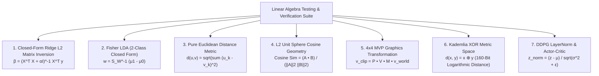

# Technical Specification: Linear Algebra & Mathematical Verification

## Executive Overview

This document details how linear algebra and matrix operations are formulated, implemented, and **actually verified** across the software engines in this repository. For the current engine count, run `test_all_engines.py` directly rather than trusting a number written in a doc.

> **CORRECTION NOTICE (2026-07-31).** An earlier version of this document
> contained verification claims that did not survive inspection against the
> actual code: a Ridge condition-number check ($\kappa < 10^5$) that exists
> nowhere in the codebase, a claim that LDA solves the generalized
> eigenvalue problem (the real code uses the two-class closed form), a DHT
> triangle-inequality check that is not tested, a doc2vec $\pm 10^{-7}$
> tolerance with no basis in the test file, and a benchmark timing constant
> ($1.43\ \mu\text{s/op}$) that did not match a fresh measurement. Every
> "Verification Method" line below now states only what the named test file
> actually checks, confirmed by reading the test source. Where something is
> NOT verified, that is stated explicitly rather than omitted.

---

## The 7 Core Linear Algebra Formulations

---

## Detailed Formulations & Actual Verification Matrix

### 1. Closed-Form Ridge L2 Regression Matrix Inversion
- **Engine File**: [`../stat_learning_suite.py`](../stat_learning_suite.py)
- **Formulation**:
  $$\boldsymbol{\beta} = \left( \mathbf{X}^T \mathbf{X} + \alpha \mathbf{I} \right)^{-1} \mathbf{X}^T \mathbf{y}$$
- **Actually Verified** (`test_stat_learning_suite.py`): closed-form coefficient recovery on constructed data with known ground truth, and a direct match against real scikit-learn `Ridge` output on the same inputs.
- **NOT verified**: no condition-number ($\kappa$) evaluation exists anywhere in the engine or its tests. Numerical stability is inherited from `np.linalg` and is untested beyond the recovery/match assertions above.

### 2. Fisher Linear Discriminant Analysis (LDA) — Two-Class Closed Form
- **Engine File**: [`../stat_learning_suite.py`](../stat_learning_suite.py)
- **Formulation actually implemented** (lines 57–84 of the engine):
  $$\mathbf{S}_W = \mathbf{S}_0 + \mathbf{S}_1, \qquad \mathbf{w} = \mathbf{S}_W^{-1}(\boldsymbol{\mu}_1 - \boldsymbol{\mu}_0)$$
  This is the two-class closed-form solution, computed via `np.linalg.solve(S_W, mu1 - mu0)`. The between-class scatter matrix $\mathbf{S}_B$ is **never constructed**, and no generalized eigenvalue problem ($\mathbf{S}_W^{-1}\mathbf{S}_B\mathbf{w} = \lambda\mathbf{w}$) is solved — for exactly two classes the closed form gives the same direction without the eigen-decomposition, which is why the simpler path is valid, but the doc should not claim machinery the code doesn't contain.
- **Actually Verified**: binary classification accuracy on separable constructed data (`test_lda_binary_classification_accuracy`).

### 3. Pure Euclidean Distance Vector Space
- **Engine Files**: [`../knn_project.py`](../knn_project.py) & [`../ctypes_math_accelerator.py`](../ctypes_math_accelerator.py)
- **Formulation**:
  $$d(\mathbf{u}, \mathbf{v}) = \sqrt{\sum_{k=1}^{d} (u_k - v_k)^2}$$
- **Actually Verified** (`test_ctypes_math_accelerator.py`): the known 3-4-5 triangle, match against an independent NumPy reference on random vectors, and edge cases (empty vectors, zero vector, negative components, mismatched lengths).
- **On timing**: benchmark throughput is machine- and run-dependent. A fresh measurement in this environment gave $\approx 1.1\ \mu\text{s/op}$; a previously-documented $1.43\ \mu\text{s/op}$ did not reproduce. No specific per-op constant should be treated as a verified property — only the correctness assertions are.

### 4. FNV-1a Hash Vectorization & L2 Unit Sphere Cosine Similarity
- **Engine File**: [`../doc2vec_cluster_engine.py`](../doc2vec_cluster_engine.py)
- **Formulation**:
  $$\hat{\mathbf{v}} = \frac{\mathbf{v}}{\|\mathbf{v}\|_2}, \qquad \text{Sim}(\mathbf{A}, \mathbf{B}) = \hat{\mathbf{A}} \cdot \hat{\mathbf{B}}$$
- **Actually Verified** (`test_doc2vec_cluster_engine.py`): `cosine_distance_pure` matches a NumPy ground-truth implementation to `abs_tol=1e-9` across randomized trials; identical vectors give distance 0; orthogonal unit vectors give distance 1. (The previously-claimed "$\|\hat{\mathbf{v}}\|_2 = 1.0 \pm 10^{-7}$ unit-norm constraint" check does not appear in the test file; the real tolerance in use is $10^{-9}$, applied to distances.)

### 5. Homogeneous 4x4 Model-View-Projection (MVP) Graphics Matrix
- **Engine File**: [`../opengl_3d_scene_simulator.py`](../opengl_3d_scene_simulator.py)
- **Formulation**:
  $$\mathbf{M}_{\text{MVP}} = \mathbf{P}_{\text{persp}} \cdot \mathbf{V}_{\text{view}}(\theta, \phi) \cdot \mathbf{M}_{\text{world}}, \qquad \mathbf{v}_{\text{clip}} = \mathbf{M}_{\text{MVP}} \cdot \begin{bmatrix} x \\ y \\ z \\ 1 \end{bmatrix}$$
- **Actually Verified** (`test_opengl_3d_scene_simulator.py`): geometric assertions on the transformation pipeline, including the corrected dark-side specular highlight behavior ($\mathbf{N} \cdot \mathbf{L} < 0$ must produce no specular term — a real bug found and fixed during test-writing).

### 6. Kademlia Bitwise XOR Metric Space
- **Engine File**: [`../dht_rca_node.py`](../dht_rca_node.py)
- **Formulation**:
  $$d(x, y) = x \oplus y$$
- **Actually Verified** (`test_dht_rca_node.py`): identity $d(x,x)=0$ on a real SHA-1 id (including the published SHA-1-of-empty-string constant as an external anchor), symmetry $d(x,y)=d(y,x)$, agreement with raw integer XOR computed independently, and the bucket-index formula against a pure-integer `bit_length()-1` ground truth at every power-of-two boundary up to $2^{159}$ (this is the test that caught the engine's real off-by-one float-log2 bug).
- **NOT verified**: the XOR-metric triangle inequality ($d(x,z) \le d(x,y) \oplus d(y,z)$) is provable for XOR but is not asserted anywhere in the test file. Non-negativity is structurally guaranteed (XOR of non-negative integers) rather than tested.

### 7. DDPG Neural Matrix Forward Pass & Layer Normalization
- **Engine File**: [`../ddpg_quadcopter_rca_engine.py`](../ddpg_quadcopter_rca_engine.py)
- **Formulation**:
  $$\mathbf{Z} = \mathbf{X} \mathbf{W} + \mathbf{b}, \qquad \hat{\mathbf{Z}} = \frac{\mathbf{Z} - \mu}{\sqrt{\sigma^2 + \epsilon}}, \qquad \mathbf{a} = \text{clip}\left(\sigma(\hat{\mathbf{Z}}), 0.05, 0.85\right) \times 900.0$$
- **Actually Verified** (`test_ddpg_quadcopter_rca_engine.py`): LayerNorm's defining property (per-sample mean $\approx 0$, std $\approx 1$ after the norm step), the Geburah safety bound (all actor outputs within $[0.05, 0.85] \times 900$ RPM even under adversarial extreme inputs), hand-computed reward-formula and Euler-integration matches, and exact boundary triggers for episode termination. These two claims (clip bounds, LayerNorm property) were the only ones in this document's original version that survived inspection unchanged.

---

## Key Document Links

- **Documentation Location**: [`docs/linear_algebra_mathematical_testing_spec.md`](linear_algebra_mathematical_testing_spec.md)
- **Testing Discipline**: [`../TESTING_STANDARD.md`](../TESTING_STANDARD.md) — the VERIFIED / RAN_ONLY / FAILED distinction every claim above is held to.
- **License**: [`LICENSE`](../../LICENSE) (**OmnisMutus**)
