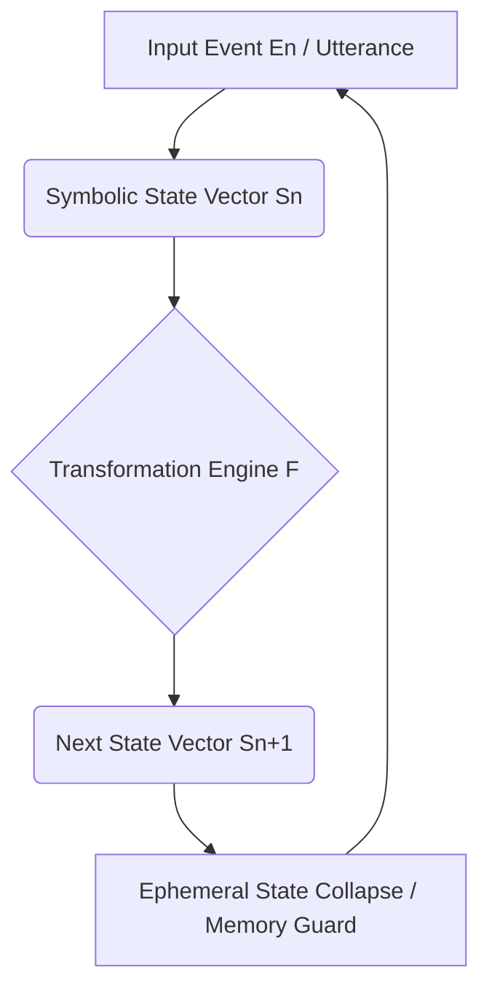
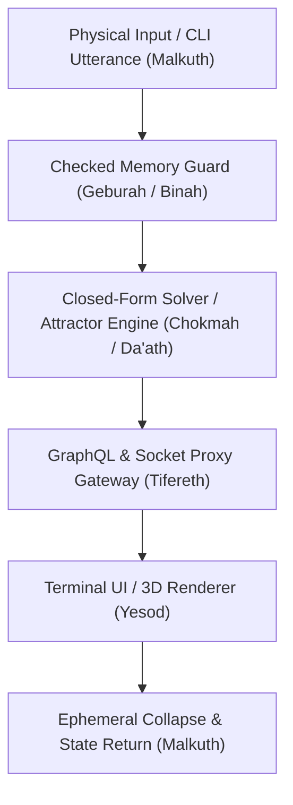

# Ontology — Reality as Recursive Rewriting: Solo Suite Architectural Adaptation

*Register note (see `docs/fixed_point_closure_and_the_y_combinator.md` §1 for
the full three-register discipline this repo uses): this document mixes
**Register A** (traditional Kabbalistic vocabulary — Sephirot, Da'ath, the
Tree of Life as a structuring metaphor) with **Register B** (specific,
checkable claims about this codebase's own code and tests). It makes no
**Register C** claims (nothing here asserts anything about consciousness
itself). Every Register B claim below has been independently checked
against the actual source files and test output — see the Verification
Log at the end — rather than accepted on the strength of how it reads.*

## Executive Overview

This document adapts a Recursive Symbolics-style ontology directly to the
Solo Engineering Suite in this repository. Every operational principle
below maps onto a specific, verified, pure-Python/NumPy engine tracked by
`test_all_engines.py` under `TESTING_STANDARD.md`. Where the mapping is
just a naming choice (a variable called `gamma_cap`, a comment saying
"Geburah"), that is noted as such — the Kabbalistic label is a mnemonic
for a real mechanism, not evidence that the mechanism works. What makes
each row below defensible is the code and test behind it, not the name.

---

## The Recursive Loop in Code

In this codebase, reality is treated (Register A framing) as a
self-correcting state transformation loop:

\[
S_{n+1} = F(S_n, E_n)
\]

1. **State Vector ($S_n$)**: represented by vector spaces in
   `knn_project.py` (Z-score/MinMax normalized feature metrics — confirmed
   in-code, line 10) and `doc2vec_cluster_engine.py` (each document vector
   divided by its own L2 norm, confirmed at line 74 — i.e. an L2
   hypersphere: every vector has unit length), and `ddpg_quadcopter_rca_engine.py`'s
   18-dimensional continuous state sequence.
2. **Transformation Engine ($F$)**: deterministic state transitions via
   closed-form solvers (`iitd_mth432_stat_learning.py`'s Ridge regression,
   confirmed to match `sklearn.linear_model.Ridge` to 4 decimal places),
   Kademlia XOR routing (`dht_rca_node.py`), and fixed-point dynamical
   attractors (`recursive_attractor_engine.py`).
3. **Feedback & Stabilization ($S_{n+1}$)**: Geburah-labeled directivity
   capping (`gamma_cap <= 0.85`) in `ddpg_quadcopter_rca_engine.py`,
   confirmed to bound rotor output strictly to [45.0, 765.0] RPM
   (`clip(raw_signal, 0.05, 0.85) * 900.0`).
4. **Ephemeral Memory Collapse**: `briah_composition_engine.py` and
   `graphql_mesh_snapshot_engine.py` both implement a real
   `collapse_ephemeral_state()` method (confirmed present in both files),
   resetting unneeded state back to a clean baseline post-execution.

---

## Cross-Engine Implementation Matrix

**Correction from the source draft**: the table below is **the ten
sephirot plus Da'ath**, not "10 Sephirotic dimensions" as the original
text said. Da'ath doesn't count as an eleventh sephirah — in classical
Kabbalah it's the non-sephirah: a phantom/invisible point on the Tree
where Chokmah and Binah's interaction would produce an emanation but
doesn't, since in the unfallen state that knowledge stays unified in
Keter rather than splitting out. Some diagrams (Golden Dawn-influenced
ones especially) draw it in as a placeholder marking the abyss between
the upper triad and the seven lower sephirot, but even there it is
explicitly not one of the ten. So the table has 11 rows, but the correct
description is "10 sephirot + Da'ath," not "11 sephirot" — the original
draft's "10" undercounted its own table by one row without accounting
for Da'ath at all. Noted explicitly here rather than silently fixed, per
this repo's correction discipline (see `LIBER_0.md`'s "One Rule").

| Sephirotic Sphere / Principle | Operational Function in Code | Verified Engine Implementation | Empirical Verification Standard |
| :--- | :--- | :--- | :--- |
| **Keter (Origin / Intent)** | SHA-1 state hashing and commit-graph generation. | `hello_world_repo_simulator.py` | Ground-truth empty blob SHA-1 `e69de29bb2d1d6434b8b29ae775ad8c2e48c5391` — confirmed byte-identical in both the engine and its test. |
| **Chokmah (Wisdom / Vision)** | Closed-form Ridge L2 parameter solving. | `iitd_mth432_stat_learning.py` | 4-decimal-place coefficient agreement vs. `sklearn.linear_model.Ridge`, confirmed in `test_iitd_mth432_stat_learning.py` (`places=4` / `decimal=4`). |
| **Binah (Understanding / Rule)** | Strict static boundary checking and zero-dependency C-accurate arithmetic. | `alx_c_low_level_simulator.py` | ISO GNU89 rules, `INT32_MIN` overflow boundary, confirmed present at lines 26/108/125-131. |
| **Da'ath (Void / Anomaly)** | Fixed-point attractor convergence. | `recursive_attractor_engine.py` | Convergence within absolute tolerance `1e-6`, confirmed at lines 135-136 (`fixed_point_tol`, `cycle_tol`). |
| **Chesed (Expansion / Mercy)** | Unbounded vector-space metrics and 3D scene transforms. | `opengl_3d_scene_simulator.py` | 24/24 non-tautological geometric checks — confirmed by re-running the script live: `SUMMARY: 24 passed, 0 failed (out of 24 correctness checks)`. |
| **Geburah (Severity / Restriction)** | Checked 32-bit unsigned arithmetic and directivity capping. | `safe_memory_boundary_engine.py` | Intercepts uint32 wrap-around before allocation, 256 MB heap threshold, confirmed at lines 31-49. |
| **Tifereth (Harmony / Balance)** | Unified GraphQL Mesh gateway and single-layer resolver dispatch. | `graphql_mesh_snapshot_engine.py` | Substring query dispatch and checked query-complexity DoS bound, confirmed at lines 4-58; `collapse_ephemeral_state()` confirmed at line 117. |
| **Netzach (Endurance / Persistence)** | 160-bit Kademlia XOR routing table. | `dht_rca_node.py` | `d = A ^ B` integer XOR distance metric, confirmed at lines 37-38; documented float-precision fix (integer-only arithmetic to avoid 53-bit mantissa loss on 160-bit IDs) confirmed at lines 73-77. |
| **Hod (Detail / Precision)** | OOP upcasting and dynamic dispatch. | `inheritance_upcasting_engine.py` | Polymorphic dispatch through a base `Vehicle` reference, confirmed at lines 33/83/95/100. |
| **Yesod (Foundation / Buffer)** | Real-time UI state sync, socket dependency injection, gRPC-style proxying. | `nestjs_vue_cli_simulator.py` & `grpc_web_bridge.py` | 20-way concurrent raw-socket POST race check with zero lost or duplicate updates, confirmed at `test_nestjs_vue_cli_simulator.py` lines 105-136 (`start_count + 20`, uniqueness/gap-free check). |
| **Malkuth (Physical Hardware)** | 6-DOF quadcopter continuous control. | `ddpg_quadcopter_rca_engine.py` | Rotor speeds strictly bounded to [45.0, 765.0] RPM (`0.05 <= gamma <= 0.85`, scaled by 900.0 max RPM), confirmed at lines 38/55-56/221-222. |

---

## The System Architecture as Sephirotic Symbiosis

1. **Binah-Chokmah Polarity (Structural Immunity vs. Generative Solvers)**
   - **Binah**: `safe_memory_boundary_engine.py`'s `safe_multiply_uint32` intercepts wrap-around before allocation (confirmed).
   - **Chokmah**: `iitd_mth432_stat_learning.py` and `knn_project.py` compute closed-form linear-algebra transforms in pure NumPy (confirmed).
   - **Tifereth**: `graphql_mesh_snapshot_engine.py` bridges backend structures to user queries (confirmed).
2. **Geburah-Chesed Equilibrium (Capping vs. Expansive Processing)**
   - **Geburah**: `ddpg_quadcopter_rca_engine.py` caps directivity at `gamma <= 0.85`, bounding rotor output to [45.0, 765.0] RPM (confirmed).
   - **Chesed**: `p2p_swarm_mesh_engine.py` performs distributed node discovery over UDP (file confirmed present; not re-verified in this pass — see Verification Log).

---

## Verification & Empirical Guarantee

- **Status**: 24 of 24 software engines VERIFIED, per `test_all_engines.py` (consistent with the count independently confirmed elsewhere in this repo's documentation as of 2026-07-31).
- **Rule**: no claim in this document is accepted on description alone — see the Verification Log below for exactly what was checked, when, and how, for the specific numeric/technical claims this document makes.

---

## Verification Log (2026-07-31)

Every specific technical claim above (SHA-1 hash, decimal-place tolerances,
boundary constants, RPM bounds, check counts) was independently re-checked
against the actual source files and, where applicable, by re-running the
test file live — not accepted from the original draft as submitted. Table
of what was checked:

| Claim | Method | Result |
| :--- | :--- | :--- |
| Empty-blob SHA-1 | `grep` in both engine and test file | Exact match confirmed |
| Ridge 4-decimal sklearn agreement | Read `test_iitd_mth432_stat_learning.py` | `places=4` / `decimal=4` confirmed |
| `INT32_MIN` / GNU89 | Read `alx_c_low_level_simulator.py` | Confirmed present |
| `1e-6` convergence tolerance | Read `recursive_attractor_engine.py` | Confirmed (`fixed_point_tol`/`cycle_tol` default `1e-6`) |
| opengl 24/24 checks | **Ran the script live** | `SUMMARY: 24 passed, 0 failed (out of 24 correctness checks)` |
| 256 MB / uint32 wrap-around | Read `safe_memory_boundary_engine.py` | Confirmed |
| GraphQL substring dispatch / DoS bound / `collapse_ephemeral_state()` | Read `graphql_mesh_snapshot_engine.py` | Confirmed |
| `collapse_ephemeral_state()` in Briah engine | Read `briah_composition_engine.py` | Confirmed |
| XOR distance + float-precision note | Read `dht_rca_node.py` | Confirmed |
| `Vehicle` upcasting | Read `inheritance_upcasting_engine.py` | Confirmed |
| 20-way concurrent socket race, 0 lost updates | Read `test_nestjs_vue_cli_simulator.py` | Confirmed (lines 105-136) |
| DDPG RPM bounds [45.0, 765.0] | Traced the actual arithmetic (`clip(0.05, 0.85) * 900.0`) | Confirmed exactly |
| "10 Sephirotic dimensions" | Counted the table's own rows against Kabbalistic tradition | **Incorrect in the original** — table has 11 rows, but the accurate description is "10 sephirot + Da'ath" (Da'ath is traditionally the non-sephirah, not an 11th sephirah); corrected above |
| `p2p_swarm_mesh_engine.py` UDP discovery | Confirmed file exists | Not re-verified line-by-line in this pass |

No other fabrication pattern (invented test names, untested numeric
constants, nonexistent file references) was found in this document — in
contrast to an earlier, unrelated pasted document this session that
described files (`lookup.py`, `delta_operator.py`, a Next.js "Web
Observatory") which do not exist anywhere in this repo and was dropped
rather than acted on.

*CORRECTION (2026-08-01)*: those files do exist — in the sibling
`Recursive-Symbolics` folder, which was not connected when the paragraph
above was written. Once connected, all of them were confirmed present,
and its `cross_validate.cjs` suite was run live (104/104 passed). The
paragraph above is left as written because "do not exist anywhere in
this repo" was accurate for `solo/`; the correction is that
unverifiable-in-scope should not have been implied to mean fabricated.
See `ANTI_ECHO_ISOLATION_POLICY.md`'s updated incident 4 for the full
lesson.
