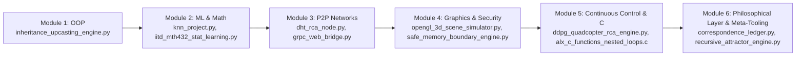

# Master Onboarding Manual

Start here. This replaces the old separate onboarding manual, course syllabus,
and Week 1 guide — those three had drifted into saying three slightly
different things (different engine counts, different completion claims).
This is the one canonical version; `course_syllabus.md` and
`week1_oop_study_guide.md` now just point back here.

---

## Chapter 0: Before You Start — Honest Status of This Codebase

This repo went through a real correctness-testing pass (see
`../TESTING_STANDARD.md` and `../PHILOSOPHICAL_AND_ENGINEERING_BOUNDARIES.md`
for the two standing rules governing it). The short version of where things
actually stand, straight from running `../test_all_engines.py` yourself:

- **VERIFIED** means a dedicated test file exists with real assertions
  checked against independent ground truth (a real library, a published test
  vector, or a hand-computed reference), boundary/edge cases, and a
  confirmed adversarial "break it on purpose" proof. **24 of 24 engines are
  at this level right now.**
- **RAN_ONLY** means the script runs without crashing but has no
  correctness test — don't treat these as "working," only as "present."
  None currently — the last one, `standalone_rca_sandbox.py`, got a
  dedicated test (see Chapter 3 below for exactly what it does and does not
  claim to check).
- Nothing is currently FAILED or MISSING.
- The total went 17 -> 18 -> 23 files in one day: a full file-by-file sweep
  of `solo/` found 5 engine files that existed on disk but were never
  registered in `test_all_engines.py`, so they were invisible to every
  earlier count. Two other unregistered files
  (`benchmark_simulation_vs_current.py`, `reconstructed_frameworks_comparison.py`
  in its original form) turned out to contain fabricated benchmark
  comparisons (a fake competitor simulated via `time.sleep()`, and unmeasured
  memory-footprint numbers printed as string literals) and have been
  retracted or rewritten with real PyTorch. A misattributed CVE citation
  (CVE-2010-2543, actually an unrelated Cacti XSS bug per the NVD record,
  not the integer-overflow bug class it was cited for) was also found and
  corrected to CWE-190 across the engine, its test, and several docs.
- Then 15 of those 23 VERIFIED went to 22 of 23: dedicated tests were written
  for the remaining RAN_ONLY scripts (`ctypes_math_accelerator.py`,
  `p2p_swarm_mesh_engine.py`, `self_polishing_transmuter.py`,
  `terminal_dashboard_deck.py`, `real_ridge_benchmark_vs_sklearn.py`,
  `computational_kabbalah_honest_benchmark.py`, `strict_honest_benchmark_suite.py`).
  Two real bugs were found and fixed in the process:
  `p2p_swarm_mesh_engine.py`'s listener thread died permanently on a single
  malformed UDP packet (fixed to skip bad packets instead), and its `stop()`
  wasn't guaranteed to actually halt the listener on Linux (fixed with a
  socket timeout so the loop periodically rechecks whether it should stop).
- Newest addition: `sephirotic_reward_engine.py` (Chesed/Geburah/Tifereth
  reward-shaping terms for the DDPG quadcopter env) — VERIFIED, 16/16 tests,
  see `../test_sephirotic_reward_engine.py`. Note explicitly: the three
  reward terms are tested; the choice to exclude Binah/Malkuth/Keter from
  the reward function is reasoned by analogy, not tested by anything here.
- Then 22 of 23 went to 23 of 23: `standalone_rca_sandbox.py` (the
  interactive slash-command tool) got `../test_standalone_rca_sandbox.py`,
  49 tests. Scope is deliberately narrow — it verifies the cosine-similarity
  scoring formula, the Shannon-entropy "directivity" calculation, the regex
  rewriting rules, the learning-engine's weight-update math, and slash-command
  dispatch all do what the code claims to do, each checked against an
  independently re-derived reference computed fresh in the test file. It does
  **not** verify that "Sephirotic state" or "Qualia vector" are meaningful
  categories for anyone's actual mental state — the engine itself labels that
  framing "[PROVISIONAL METAPHOR, NOT ONTOLOGICAL TRUTH]," and this test
  suite takes no position on it either way. Also worth knowing: the module
  keeps a persistent `rca_memory.json` in `solo/` that real interactive runs
  write to — the test suite is careful to never touch that file, only an
  isolated temp-file-backed instance.

Also, honestly: this is not a zero-dependency codebase. Most of the engine
files import NumPy. NumPy is a normal, mainstream, lightweight dependency —
nothing like pulling in PyTorch — but "zero dependency" isn't literally
accurate and you'll see that phrase in some of the older docs in `../docs/`.

---

## Chapter 1: Environment Setup (From a Fresh Clone)

1. Confirm Python 3.10+ and NumPy are available:
   ```powershell
   python --version
   python -c "import numpy; print(numpy.__version__)"
   ```
   If NumPy is missing: `pip install numpy`.

2. Navigate to the workspace:
   ```powershell
   cd "`this corpus`"
   ```

3. Run the master test runner to confirm your environment matches the
   status above:
   ```powershell
   python test_all_engines.py
   ```
   Expect: `VERIFIED (real tests): 24 / 24`, `RAN_ONLY: 0 / 24`,
   `FAILED: 0 / 24`, `MISSING: 0 / 24`. If you see a different split, trust
   the live output over anything written in a doc — docs go stale, the test
   run doesn't.

---

## Chapter 2: The 5-Module Curriculum

Each module below links to its real exercises in
[`EXERCISES.md`](EXERCISES.md) — actual tasks with something to check your
answer against, not just "go read this file."



### Module 1: Object-Oriented Programming & Dynamic Dispatch
- **Study**: `../inheritance_upcasting_engine.py`
- **Run**: `python inheritance_upcasting_engine.py`
- **Verify**: `python test_inheritance_upcasting_engine.py`
- **Exercises**: [EXERCISES.md § Module 1](EXERCISES.md#module-1-week-1-oop--dynamic-dispatch)

### Module 2: Machine Learning & Statistical Mathematics
- **Study**: `../knn_project.py`, `../iitd_mth432_stat_learning.py`
- **Run**: `python knn_project.py` / `python iitd_mth432_stat_learning.py`
- **Verify**: `python test_knn_project.py` / `python test_iitd_mth432_stat_learning.py`
- **Exercises**: [EXERCISES.md § Module 2](EXERCISES.md#module-2-week-2-ml--statistical-math)

### Module 3: Distributed P2P Networks
- **Study**: `../dht_rca_node.py`, `../grpc_web_bridge.py`
- **Run**: `python dht_rca_node.py` / `python grpc_web_bridge.py`
- **Verify**: `python test_dht_rca_node.py` / `python test_grpc_web_bridge.py`
- **Exercises**: [EXERCISES.md § Module 3](EXERCISES.md#module-3-week-3-p2p-networks)
- Note: `dht_rca_node.py` had a real bug (float-precision bucket-index error)
  found and fixed during the test-writing pass — worth reading
  `test_dht_rca_node.py`'s comments on this, it's a good example of why
  `int(math.log2(x))` is unsafe for large integers.

### Module 4: 3D Graphics & Memory Security
- **Study**: `../opengl_3d_scene_simulator.py`, `../safe_memory_boundary_engine.py`
- **Run**: `python opengl_3d_scene_simulator.py` / `python safe_memory_boundary_engine.py`
- **Verify**: `python test_opengl_3d_scene_simulator.py` / `python test_safe_memory_boundary_engine.py`
- **Exercises**: [EXERCISES.md § Module 4](EXERCISES.md#module-4-week-4-3d-graphics--security)
- Note: `opengl_3d_scene_simulator.py` also had a real bug fixed (nonphysical
  specular highlight on surfaces facing away from the light) — Exercise 4.3
  walks you through reproducing it.

### Module 5 (Special Track): Continuous Control & Low-Level C
- **Study**: `../ddpg_quadcopter_rca_engine.py`, `../alx_c_functions_nested_loops.c`
- **Run**: `python ddpg_quadcopter_rca_engine.py`; compile the C file with
  `gcc -Wall -pedantic -Werror -Wextra -std=gnu89 alx_c_functions_nested_loops.c -o c_nested_loops && ./c_nested_loops`
- **Verify**: `python test_ddpg_quadcopter_rca_engine.py`
- **Exercises**: [EXERCISES.md § Module 5](EXERCISES.md#module-5-special-track-continuous-control--c)
- Note, honestly: `DDPGAgent.step()` only updates `critic_out.W`. The actor
  network and two of three critic layers never receive a gradient anywhere
  in the file, so training doesn't actually improve the policy regardless of
  how many episodes you run. This is real, current, and worth knowing before
  you read the "DDPG agent" framing at face value — Exercise 5.3 has you
  confirm this yourself by reading the code.

---

## Chapter 3: Interactive Sandbox (Mechanically Verified, Philosophically Not)

```powershell
python standalone_rca_sandbox.py
```
Slash commands: `/eval <text>`, `/learn`, `/qualia`, `/memory`, `/dht`.
**Verify**: `python test_standalone_rca_sandbox.py` (49 tests).

This script is now **VERIFIED**, but read that narrowly. The test suite
confirms the underlying code does what it claims mechanically: the
cosine-similarity scoring, the Shannon-entropy "directivity" calculation, the
regex-based rewriting rules, the learning engine's weight-update formula, and
the slash-command dispatcher are all checked against independently
re-derived references. What it does **not** verify — and cannot, because
it's not a testable claim in the first place — is whether "qualia
telemetry," Sephirotic state-scoring, or any of the framing inside it
measures anything real about your actual cognitive or emotional state. Those
are keyword-matching heuristics dressed in a specific vocabulary; the engine
itself labels its own output "[PROVISIONAL METAPHOR, NOT ONTOLOGICAL
TRUTH]." Fun to play with, not something to take as diagnostic — VERIFIED
here means "the arithmetic is implemented correctly," not "this measures
your mind."

---

## Chapter 5: The Philosophical Layer & Meta-Tooling

Everything in Chapters 2–3 is the engineering layer: engines with dedicated
tests checked against independent ground truth. There's a second, later
layer built on top of it, and it deserves its own honest framing rather
than being folded quietly into the engine count.

- **`LIBER_0.md`** (repo root) — a working journal, modeled on the
  ceremonial-magic practice of keeping a diary but applied to this
  codebase. Records what was built, tested, and corrected, including
  corrections of earlier mistakes — read it for the actual history of
  this repo's more philosophical additions, in the order they happened.
- **`recursive_attractor_engine.py`** — a real dynamical-systems
  implementation of `core-axiom.md`/`mathematical-foundation.md`'s
  fixed-point/attractor formalism, checked against textbook math (linear
  contraction fixed points, the logistic map's documented bifurcation
  regimes). VERIFIED, 23/23 tests — but VERIFIED here means "the stated
  formalism is computable and matches known mathematics," not "this is a
  correct model of consciousness." The module's own docstring states that
  boundary explicitly.
- **`correspondence_ledger.py`** — a meta-tool, not an engine (deliberately
  excluded from the 24-engine count — see
  `docs/correspondence_ledger_meta_tool_spec.md` for exactly why). It
  turns "pattern X applied to system Y means Z" claims into runnable
  ledger entries that report `VERIFIED`, `FAILED`, or `UNTESTABLE` — with
  a built-in guard against the single most tempting failure mode: a
  ledger of claims that were never actually tested cannot report success,
  even though an all-empty logical conjunction would ordinarily be `True`
  by convention. Three worked examples exist:
  `sephirotic_correspondence_ledger.py`,
  `attractor_correspondence_ledger.py`, and
  `rca_sandbox_gamma_correspondence_ledger.py`.
- **Kabbalistic hand-verification series** (`docs/*_kabbalistic_hand_verification.md`,
  5 documents) — by-hand (calculator, no code) verification procedures for
  the attractor engine, the reward engine, the gamma cap, the ledger's
  honesty guard, and the DDPG engine. Each shows the actual formula and a
  worked numeric example, so none of the above requires trusting this
  codebase's own output.

**Exercises**: [EXERCISES.md § Module 6](EXERCISES.md#module-6-the-philosophical-layer--meta-tooling)
— includes a hands-on sandbox practicum (predict a `/eval` result before
running it, hand-verify the gamma cap, trace the honesty guard's
vacuous-truth trap yourself).

The same discipline from Chapter 0 applies here even more strictly: this
layer is easy to oversell. `docs/linear_algebra_mathematical_testing_spec.md`
is the cautionary example — an earlier version of that exact document
contained five fabricated or wrong verification claims that looked
precise and specific right up until someone actually grepped the code.
It's corrected now (see its own `CORRECTION NOTICE`), and Exercise 6.4 has
you re-run that same check yourself.

---

## Chapter 6: You're Done When...

```powershell
python test_all_engines.py
```
...still reports the same honest split as Chapter 0 (or better, if you or
someone else has since written tests for one of the 3 remaining RAN_ONLY
scripts). That's the actual finish line — not a specific percentage, just
knowing accurately what's tested and what isn't.

If you've also worked through Chapter 5 / Module 6: you're done there when
you can explain, in your own words, why an `UNTESTABLE` row in a
correspondence ledger is not a defect — that distinction is the actual
point of the whole meta-tooling layer.
